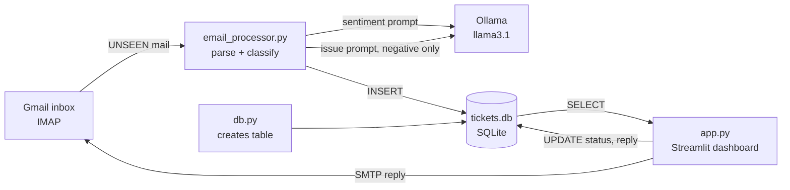

# GenAI-Driven Intelligent Email Ticketing

Reads a support inbox, uses a local Llama 3.1 model to sort complaints into teams, and gives each team a Streamlit dashboard to reply from.

<!-- TODO(demo): badges for CI and license once the workflow from task ticketing-003 is merged -->
<!-- TODO(demo): docs/demo.gif (under 10 MB, about 800 px wide) recorded from the seeded database -->

[](https://www.youtube.com/watch?v=66db5RdDg58)

## Why it exists

Service teams in logistics and customer support get complaint emails that someone has to read, label and forward by hand. This project does the first pass locally: it flags negative mail, picks an issue category and a specific issue, and puts the ticket in front of the right team. No email text leaves your machine, because the model runs in Ollama.

It was built as part of a research project for ICACECS 2025.

## Features

- IMAP polling of a Gmail inbox for unread mail (`email_processor.py`, `check_email`), every 6 seconds.
- Parsing of sender, subject and the first plain-text part; the body is stored truncated to 500 characters.
- Sentiment check with a local Ollama model (`llama3.1`) through a LangChain prompt chain: positive mail needs no action.
- Issue classification of negative mail into 1 of 10 categories and a specific issue (50 in total) from the built-in issue dictionary.
- SQLite storage of every ticket: timestamp, sender, subject, body, sentiment, category, specific issue, status, reply (`db.py`).
- Streamlit dashboard (`app.py`): totals, open tickets, category bar chart, sentiment chart, ticket volume over time, 10 most recent tickets.
- One page per team with its open tickets; write a reply, send it by SMTP and close the ticket in one click. Closed tickets are listed with their replies.

## Architecture



The original diagram is in `architecture.png`.

## Tech stack

Python, Streamlit, pandas, Plotly, streamlit-option-menu, SQLite, LangChain (`langchain_ollama`, `langchain_core`), Ollama with llama3.1, imaplib and smtplib from the standard library.

## Quick start

You need Python 3.10 or newer, [Ollama](https://ollama.com/), and a Gmail account with an app password if you want to read or send real mail.

```bash
git clone https://github.com/Naresh23032003/GenAI-Driven-Intelligent-Email-Ticketing.git
cd GenAI-Driven-Intelligent-Email-Ticketing
pip install -r requirements.txt
ollama pull llama3.1
python db.py
streamlit run app.py
```

The dashboard opens at `http://localhost:8501`.

<!-- TODO(demo): confirm these commands on a clean machine after tasks ticketing-001 and ticketing-002 are merged; today requirements.txt is missing plotly, streamlit-option-menu, langchain-ollama and langchain-core -->

To process live mail, set the variables below and run the poller in a second terminal:

```bash
python email_processor.py
```

To try the dashboard without Gmail or Ollama, `sample_data/` holds a sample database.
<!-- TODO(demo): verify what sample_data/ contains and how many emails (the old README says 500), then give the exact copy command; task ticketing-005 adds scripts/seed_demo.py -->

## Configuration

Set these environment variables (introduced by task ticketing-002; see `.env.example`):

| Variable | Used by | Purpose |
|---|---|---|
| `EMAIL_ACCOUNT` | both | Gmail address |
| `EMAIL_PASSWORD` | both | Gmail app password |
| `IMAP_SERVER` | `email_processor.py` | IMAP host, default `imap.gmail.com` |
| `DB_PATH` | both | SQLite file, default `tickets.db` |
| `OLLAMA_MODEL` | `email_processor.py` | model name, default `llama3.1` |

Never commit real credentials.

## Tests

<!-- TODO(demo): add the real command and result after tasks ticketing-001 and ticketing-003 -->
Planned: `pytest` with a stubbed model, so tests need neither Ollama nor Gmail.

## Project structure

```
app.py              Streamlit dashboard and SMTP reply
db.py               creates the tickets table in SQLite
email_processor.py  IMAP polling, parsing, LLM sentiment and issue classification
sample_data/        sample data for the dashboard
architecture.png    architecture diagram
demo_video.mp4      recorded demonstration (about 20 MB)
requirements.txt    Python dependencies
```

## Roadmap

- Fix the classification fallback so unparseable model output becomes an "Uncategorized" ticket (task ticketing-001).
- Environment-based configuration and a complete `requirements.txt` (task ticketing-002).
- CI with lint and tests (task ticketing-003).
- Dashboard fixes: visible send errors, daily ticket volume (task ticketing-004).
- Split `email_processor.py` into parse, classify and store modules; Docker Compose with Ollama.

## License

MIT. See `LICENSE`.

## Authors

Naresh R and Sreeja Sunkeswaram.
